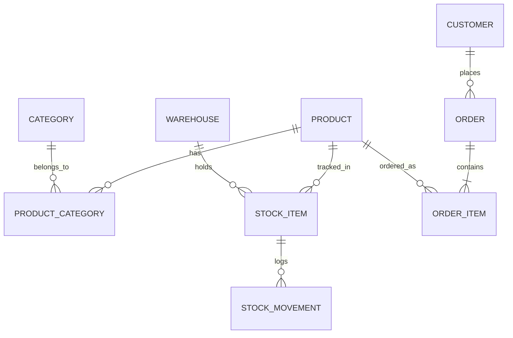
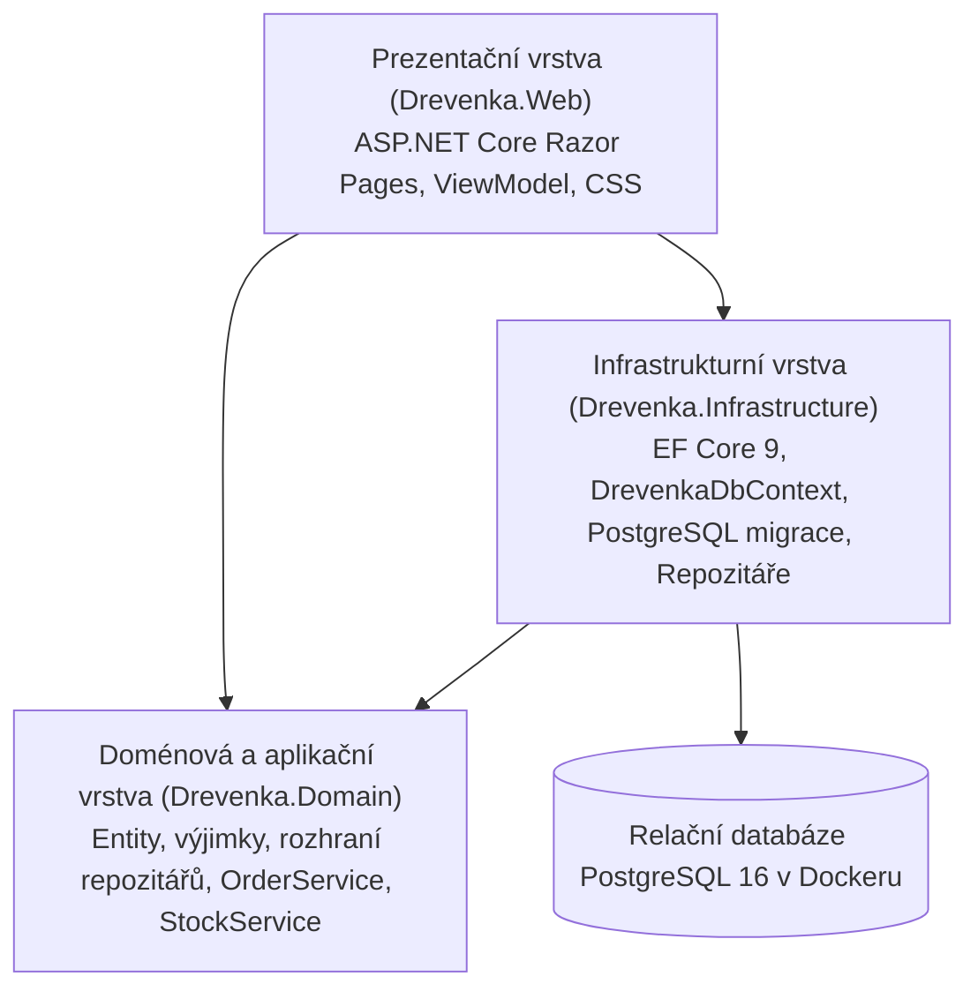

# Pokročilé programování (PPRO), zimní semestr 2026/2027
**Fakulta informatiky a managementu, Univerzita Hradec Králové**

## Dokumentace semestrálního projektu

| Parametr | Hodnota |
| :--- | :--- |
| **Název projektu** | Sklad pro malý e-shop (Dřevěnka s.r.o.) |
| **Zvolené zadání** | Zadání B: Sklad pro malý e-shop |
| **Jméno a příjmení** | Marek Ludvík |
| **Repozitář na GitHubu** | [https://github.com/M4reg/ppro2026](https://github.com/M4reg/ppro2026) |
| **Datum poslední úpravy** | 21. 11. 2026 |

---

## 1. Popis řešení

### 1.1 Pro koho je aplikace určena a jaký problém řeší
Pan Petr Doležal podniká deset let v zakázkové a malosériové výrobě tradičních českých dřevěných hraček pod obchodní značkou **Dřevěnka s.r.o.**. Poslední tři roky zaznamenala firma výrazný nárůst poptávky a tržeb z e-shopu, avšak její vnitřní provoz zůstal závislý na původním, již nevyhovujícím způsobu evidence.

Zásadní provozní komplikace způsoboval **jeden centrální tabulkový soubor v MS Excel** obsahující přibližně 400 položek sortimentu. Tabulku měli současně otevřenou tři pracovníci na různých počítačích v kanceláři a v expedičním skladu, což vedlo k neustálému zamykání souboru pro zápis, vzniku konfliktních kopií a přepisování rozpracovaných dat. Situaci dále komplikovala existence **dvou oddělených fyzických skladů**:
1. *Centrální sklad v Hradci Králové* (centrála firmy, hlavní expediční místo pro kurýrní služby a osobní odběry).
2. *Sklad v Třebechovicích pod Orebem* (zrekonstruovaná garáž sloužící jako vyrovnávací sklad pro sezónní zásoby, materiál a výrobní přebytky).

Objednávky z internetového obchodu přicházely do e-mailové schránky a pracovníci expedice je ručně přepisovali do Excelu. Kvůli zpoždění zápisu a absenci centrálního zamykání stavů docházelo přibližně dvakrát do měsíce k **prodeji zboží, které již reálně nebylo skladem**. Zákazníkům bylo nutné telefonicky vysvětlovat storno objednávky, což poškozovalo reputaci firmy. Druhým kritickým problémem byly **neevidované fyzické přesuny** beden se zbožím mezi Třebechovicemi a Hradcem Králové – stav v třebechovické garáži v tabulce dlouhodobě neodpovídal realitě a nebylo možné dohledat, kdo, kdy a kam konkrétní položky přesunul.

### 1.2 Co aplikace dělá
Cílem projektu bylo nahradit neudržitelný tabulkový proces robustním, centralizovaným webovým systémem skladového hospodářství s těmito klíčovými funkcemi:
- **Katalog produktů a zařazení do kategorií (vazba M:N):** Každý produkt má název, unikátní kód (SKU), popis, nákupní a prodejní cenu s automatickým výpočtem obchodní marže. Produkty mohou být zařazeny do libovolného množství kategorií současně (např. dřevěná káča patří do kategorií *Pro nejmenší* i *Dárky do 300 Kč*).
- **Víceskladové zásoby a dvoustupňový model:** Sledování fyzického množství, rezervovaného množství a disponibilních zásob odděleně pro sklad Hradec Králové i sklad Třebechovice.
- **Automatické odmítnutí objednávky při nedostatku zásob:** Při vytváření zákaznické objednávky systém ověřuje disponibilní zásoby. Pokud na skladě není dostatek volných kusů, systém objednávku striktně odmítne a neumožní její založení.
- **Okamžitá rezervace a odložený výdej:** Při úspěšném vytvoření objednávky jsou kusy okamžitě zarezervovány (čímž se poníží disponibilní zásoba pro další zákazníky). K fyzickému odepsání z regálu a vytvoření výdejového pohybu dochází až v okamžiku expedice balíku.
- **Kompletní auditní stopa skladových pohybů:** Žádné číslo v systému se nemění bez průkazného dokladu. Každý příjem, výdej, meziskladový převoz i inventurní rozdíl je zaznamenán jako neměnný pohyb s časovým razítkem, skladem a referencí na objednávku či důvod.
- **Zákaz záporného stavu zásob:** Databáze na úrovni integrity neumožňuje pokles fyzické zásoby pod nulu (`CHECK (quantity_on_hand >= 0)`).
- **Řízení inventur:** Nesrovnalosti zjištěné v odlehlém skladu se řeší speciálním inventurním vyrovnáním, které vyžaduje povinné textové odůvodnění manka či přebytku.
- **Ochrana zákaznických dat:** Zákazníci se z databáze fyzicky nemažou, aby bylo možné kdykoliv dohledat historii nákupů a řešit případné reklamace.

### 1.3 Jak je aplikace postavena a architektura
Aplikace je navržena podle zásad **čisté třívrstvé architektury** v platformě **.NET 9 (C#)** s jednosměrným tokem závislostí:
1. **Prezentační vrstva (`Drevenka.Web`):** Realizována technologiemi ASP.NET Core Razor Pages. Uživatelské rozhraní je stylizováno do čistého řemeslného vizuálu („Workshop Craft“) s paletou dřeva, písku a lesní zeleně. Rozhraní je plně responzivní s důrazem na ergonomické ovládání z mobilních telefonů přímo mezi regály ve skladu.
2. **Aplikační a doménová vrstva (`Drevenka.Domain`):** Samostatná knihovna neobsahující žádné závislosti na databázi ani webovém frameworku. Obsahuje doménové entity (`Product`, `Category`, `ProductCategory`, `Warehouse`, `StockItem`, `StockMovement`, `Customer`, `Order`, `OrderItem`), hodnotové objekty, rozhraní repozitářů a doménové služby (`OrderService`, `StockService`, `ProductService`, `CategoryService`). Zde jsou zapouzdřena veškerá obchodní pravidla.
3. **Infrastrukturní a persistenční vrstva (`Drevenka.Infrastructure`):** Zajišťuje perzistenci pomocí Entity Framework Core 9 a PostgreSQL provideru (`Npgsql.EntityFrameworkCore.PostgreSQL`). Řídí verzované databázové migrace, konfiguraci integritních omezení (Fluent API) a implementaci repozitářů.
4. **Databáze:** Relační databáze **PostgreSQL 16** provozovaná v Docker kontejneru.
5. **Orchestrace:** Celé řešení (databáze i webová aplikace) se spouští jedním příkazem prostřednictvím **Docker Compose**.

---

## 2. Rozhodnutí

V následující tabulce jsou zaznamenána klíčová architektonická a technologická rozhodnutí projektu včetně jejich věcného zdůvodnění:

| Č. | Rozhodnutí | Důvod | Datum |
| :--- | :--- | :--- | :--- |
| **R1** | Třívrstvá architektura se striktně jednosměrnými závislostmi (`Web` ➔ `Infrastructure` ➔ `Domain`, `Domain` je zcela nezávislá) | Povinné minimum předmětu PPRO; čisté zapouzdření doménových pravidel bez vazby na framework; možnost testovat byznys logiku bez nutnosti spouštět databázi. | 30. 9. 2026 |
| **R2** | Platforma .NET 10 (Preview) | *Nahrazeno R2b.* | 30. 9. 2026 |
| **R2b** | Backend v C# a ASP.NET Core Razor Pages na stabilním .NET 9 LTS | Přechod z nestabilního preview .NET 10 na stabilní .NET 9 s plnou podporou oficiálních Docker SDK obrazů; Razor Pages poskytují přehledný server-side rendering pro interní firemní systém bez nutnosti budovat a spravovat oddělenou SPA aplikaci. | 7. 10. 2026 |
| **R3** | Relační databáze PostgreSQL 16 v kontejneru Docker | Zadání předmětu vyžaduje relační databázi v kontejneru; PostgreSQL nabízí vysokou spolehlivost, striktní transakční integritu a shodné chování v lokálním vývoji i při obhajobě u vyučujícího. | 30. 9. 2026 |
| **R4** | ORM nástroj Entity Framework Core 9 (Npgsql) s verzovanými migracemi | Verzované migrace v kódu zajišťují reprodukovatelnost schématu od prázdné databáze; silně typované LINQ dotazy; deklarativní konfigurace vztahů 1:N i M:N přes Fluent API. | 30. 9. 2026 |
| **R5** | Dvoustupňový model zásob: Disponibilní zásoba = Fyzická zásoba − Rezervace v otevřených objednávkách | Klient požadoval okamžité odmítnutí nové objednávky při nedostatku kusů, avšak fyzický odpis z regálu nastává až při balení a expedici; expedice se provádí vždy z centrály v Hradci Králové, pro zboží v Třebechovicích se generuje interní přesun. | 30. 9. 2026 |
| **R6** | Striktní zákaz záporného stavu na úrovni DB (`CHECK (quantity_on_hand >= 0)`) a auditní stopa | Požadavek klienta na vyloučení výdeje do záporu za jakýchkoliv okolností; nesrovnalosti v odlehlé garáži se řeší výhradně modulem Inventura s povinným textovým odůvodněním a auditním záznamem typu `INVENTORY_DISCREPANCY`. | 30. 9. 2026 |
| **R7** | Explicitní spojovací entita `ProductCategory` pro vazbu M:N | Hračky typicky patří do více kategorií současně (např. věkové určení i cenové hladiny); explicitní entita umožňuje budoucí rozšíření o metadata (např. pořadí řazení). | 4. 11. 2026 |
| **R8** | Vlastní řemeslný workshop design systém (paleta dřevo, písek, terakota, eben) bez generických AI gradientů a zaoblení | Vizuální styl přizpůsobený truhlářské a řemeslné dílně pana Doležala; odstraněny rušivé nafouklé stíny a kulaté tvary; vysoký kontrast a ergonomie pro čtení na mobilu ve skladu. | 7. 10. 2026 |
| **R9** | Testovací strategie: Jednotkové testy (xUnit + FluentAssertions) pro doménovou logiku + Integrační testy (`PostgreSqlDatabaseFixture`) proti PostgreSQL | Splnění požadavku PPRO na automatizované testy aplikační logiky a alespoň jeden reálný test proti relační databázi; ověření funkčnosti migrací a integritních omezení přímo v databázovém stroji. | 18. 11. 2026 |
| **R10** | Zákaz fyzického mazání zákazníků (pouze logické vazby) | Požadavek klienta: zákazníci se vracejí s dotazy a reklamacemi, smazání zákazníka by zneplatnilo historické doklady a auditní stopu. | 11. 11. 2026 |

---

## 3. Změny požadované klientem

V souladu s pokyny vyučujícího jsou v tomto oddílu zaznamenány konkrétní podněty a výhrady, se kterými klient (a vyučující na konzultacích) přišel v průběhu vývoje aplikace:

| Č. | Datum | Požadavek klienta | Řešení a dopad na návrh | Stav |
| :--- | :--- | :--- | :--- | :--- |
| **Z1** | 7. 10. 2026 | „V horním menu mi hrozně vadí ten nakreslený rámeček okolo nápisu Sklad online. Vypadá to jako vygenerované z levné AI šablony a bije to zbytečně do očí.“ | V `_Layout.cshtml` a `site.css` byl odstraněn hrubý rámeček s kontrastním okrajem (`border border-wood-sand px-2 py-1 bg-wood-pine`). Prvek byl nahrazen decentním řemeslným indikátorem `.craft-status-tag` s jemným stavovým puntíkem a sladěnou typografií. Viz R8. | hotovo |
| **Z2** | 7. 10. 2026 | „Ikonky v horním navigačním menu se mi na některých šířkách obrazovky zalamují nad text položek a vypadá to rozbitě. Chci mít ikonu a text vždy hezky vedle sebe na jednom řádku.“ | Do stylů navigačních odkazů `.navbar-wood .nav-link` byla doplněna pravidla `display: inline-flex; align-items: center; white-space: nowrap;` s fixním marginem u ikony `flex-shrink: 0`. Tím bylo striktně zabráněno nechtěnému odskočení či zalomení ikony nad textový popisek. | hotovo |
| **Z3** | 7. 10. 2026 | „V textech a nadpisech máte zbytečné pomlčky a akademické zkratky jako (M:N). Skladník v tom má zmatek a nechce v ostrém systému číst školní teorii.“ | Z uživatelského rozhraní byly odstraněny akademické a teoretické popisy – např. text „Zařazení do kategorií (M:N)“ byl přepsán na přirozené „Zařazení do kategorií“, odstraněny zmínky o školním zadání a nadbytečné spojovníky v titulcích. | hotovo |
| **Z4** | 11. 11. 2026 | „Při mobilním zobrazení nechci mít menu stále roztažené přes celou obrazovku. Chci, aby se otevřelo až po kliknutí na hamburger ikonu a jakmile skladník klikne na podstránku, ať se menu zase samo zavře.“ | V `_Layout.cshtml` byla obnovena responzivní navigační lišta Bootstrapu (`navbar-expand-lg`) s hamburger tlačítkem. Doplněn klientský JavaScript, který po kliknutí na libovolný navigační odkaz automaticky menu sbalí, aby nezaclánělo pracovní ploše. | hotovo |
| **Z5** | 7. 10. 2026 | „V patičce a u cen se mi zobrazuje podivný symbol měny ¤ místo českých korun a patička mi visí uprostřed stránky, když je v tabulce málo zboží.“ | V `Program.cs` byla explicitně nastavena výchozí kultura `cs-CZ`, čímž bylo zajištěno správné formátování měny v Kč. V CSS byl implementován flexbox layout se sticky footerem (`min-vh-100` a `mt-auto`), takže patička drží vždy u spodního okraje okna. | hotovo |
| **Z6** | 7. 10. 2026 | „Když kliknu na detail hračky nebo na formulář, celá stránka uskočí do jiné šířky než hlavní katalog produktů.“ | Byla zavedena globální sjednocená třída `.app-container` (s pevnou maximální šířkou 1140 px a jednotným paddingem) napříč všemi stránkami i drobečkovou navigací. Odstraněno nežádoucí poskakování layoutu. | hotovo |
| **Z7** | 11. 11. 2026 | „Když zákazník na e-shopu objedná 10 dřevěných káč a my máme na skladě jen 3, systém mu to nesmí dovolit potvrdit. A zásoby z regálu nechci odepisovat hned při objednávce, ale až když balík skladník fyzicky zabalí a expeduje.“ | Implementován dvoustupňový model zásob v `OrderService`: při založení objednávky se testuje disponibilní zásoba; při nedostatku systém vyhodí `InsufficientStockException` a objednávku odmítne. Při dostatku dojde k okamžité rezervaci. Fyzický výdejový pohyb (`StockMovement`) se zapíše až při přechodu do stavu `Expedováno`. Viz R5. | hotovo |
| **Z8** | 11. 11. 2026 | „V garáži v Třebechovicích stav často nesedí a nesmí se stát, že by sklad šel do mínusu, to by byl v účetnictví průšvih.“ | Do schématu databáze PostgreSQL byl přidán integritní check constraint `ck_stock_items_quantity_on_hand` (`quantity_on_hand >= 0`). Pro vyrovnání skutečného stavu byl vytvořen modul Inventura vyžadující povinné textové odůvodnění a vytvářející auditní záznam. Viz R6. | hotovo |
| **Z9** | 11. 11. 2026 | „Zákazníci se k nám vracejí s dotazy a reklamacemi, takže jejich kontakty ani staré objednávky se z databáze nesmí dát smazat.“ | V doménovém modelu a repozitáři bylo fyzické mazání zákazníků zakázáno. V rozhraní byl doplněn detail zákazníka se souhrnným přehledem všech jeho historických objednávek. Viz R10. | hotovo |
| **Z10** | 4. 11. 2026 | „Potřebuji, aby jedna hračka (třeba káča) šla zařadit do více kategorií najednou – např. pro nejmenší i dárky do 300 Kč.“ | Vytvořena vazba M:N mezi entitami `Product` a `Category` pomocí propojovací tabulky `product_categories`. Formuláře pro vytvoření i editaci produktu byly doplněny o vícenásobný výběr kategorií a katalog o filtrování dle kategorií. Viz R7. | hotovo |

---

## 4. Datový model

Datový model aplikace pokrývá **9 plnohodnotných relačních entit** s bohatými vazbami překračujícími povinné minimum semestrální práce (vyžadováno min. 5 entit a 1 vazba M:N):



### Popis klíčových entit a vazeb:
1. **`Product` (Produkt):** Představuje dřevěnou hračku v nabídce.
   - *Klíčové atributy:* `Id` (PK), `Code` (SKU kód, unikátní index), `Name`, `Description`, `PurchasePrice` (nákupní cena >= 0), `SellingPrice` (prodejní cena >= 0), `IsActive`, `CreatedAt`.
2. **`Category` (Kategorie):** Tématické zařazení produktů v e-shopu.
   - *Klíčové atributy:* `Id` (PK), `Name` (unikátní index), `Description`, `IsActive`.
3. **`ProductCategory` (Vazba M:N):** Propojovací entita realizující vazbu M:N mezi produkty a kategoriemi.
   - *Klíčové atributy:* Složený primární klíč `(ProductId, CategoryId)` s cizími klíči a kaskádním mazáním vazeb.
4. **`Warehouse` (Sklad):** Fyzické skladové prostory.
   - *Klíčové atributy:* `Id` (PK), `Code` (např. `HK-CENTRAL`, `TREB-GARAGE`), `Name`, `Address`, `IsActive`.
5. **`StockItem` (Skladová zásoba položky):** Stav konkrétního produktu na konkrétním skladě.
   - *Klíčové atributy:* `Id` (PK), `ProductId` (FK), `WarehouseId` (FK), `QuantityOnHand` (fyzický stav na regále, integritní omezení `>= 0`), `QuantityReserved` (rezervováno v objednávkách `>= 0`), `MinimumStockLevel` (bezpečná hladina zásob), `LastRestockedAt`.
   - *Vypočítávaná vlastnost:* `QuantityAvailable = QuantityOnHand - QuantityReserved`.
6. **`StockMovement` (Skladový pohyb):** Neměnný auditní záznam každé operace se zásobami.
   - *Klíčové atributy:* `Id` (PK), `StockItemId` (FK), `Type` (enum: `Receipt`, `Dispatch`, `TransferIn`, `TransferOut`, `InventoryDiscrepancy`), `Quantity` (kladná hodnota), `OccurredAt`, `Note`, `PerformedBy`, `ReferenceNumber` (číslo objednávky či přesunky).
7. **`Customer` (Zákazník):** Odběratel zboží.
   - *Klíčové atributy:* `Id` (PK), `FullName`, `Email` (indexováno), `Phone`, `Address`, `CreatedAt`, `Notes`. Fyzické mazání je zakázáno.
8. **`Order` (Zákaznická objednávka):** Objednávka vystavená zákazníkem.
   - *Klíčové atributy:* `Id` (PK), `OrderNumber` (např. `OBJ-2026-0001`, unikátní), `CustomerId` (FK), `Status` (enum: `Draft`, `PendingReservation`, `Confirmed`, `Dispatched`, `Cancelled`), `CreatedAt`, `DispatchedAt`, `TotalAmount`.
9. **`OrderItem` (Položka objednávky):** Řádek objednávky s cenovým snapshotem.
   - *Klíčové atributy:* `Id` (PK), `OrderId` (FK), `ProductId` (FK), `Quantity` (> 0), `UnitPrice` (prodejní cena fixovaná v okamžiku nákupu), `TotalPrice`.

---

## 5. Architektura a vrstvy

Projekt striktně dodržuje třívrstvou architekturu se závislostmi orientovanými výhradně jedním směrem:



### Zajištění jednosměrných závislostí:
- **`Drevenka.Domain`** je jádrem systému. Nemá žádnou referenci na ostatní projekty solution ani na externí databázové balíčky. Obsahuje pouze čistý C# kód. Definuje rozhraní repozitářů (`IProductRepository`, `ICategoryRepository`, `IWarehouseRepository`, `IStockRepository`, `ICustomerRepository`, `IOrderRepository`), která jsou volána doménovými službami.
- **`Drevenka.Infrastructure`** závisí na `Drevenka.Domain`. Implementuje výše uvedená rozhraní pomocí Entity Framework Core a Npgsql. Mapování entit na tabulky probíhá deklarativně přes Fluent API v `DrevenkaDbContext`.
- **`Drevenka.Web`** závisí na `Drevenka.Domain` (pro DTO a služby) a `Drevenka.Infrastructure` (výhradně pro registraci závislostí v IoC kontejneru v `Program.cs`). Samotné Razor Pages komunikují výhradně přes doménové služby a abstrakce repozitářů; v prezentační vrstvě se nenachází žádný SQL příkaz ani přímý přístup k `DbContext`.

---

## 6. Použité technologie

| Technologie | Důvod volby |
| :--- | :--- |
| **C# / .NET 9 LTS** | Moderní, silně typovaný jazyk a vysoce výkonná platforma s dlouhodobou podporou. |
| **ASP.NET Core Razor Pages** | Přehledný server-side rendering s modelem stránky, ideální pro firemní CRUD a transakční formuláře. |
| **Entity Framework Core 9** | Pokročilé ORM s plnou podporou verzovaných migrací v C#, LINQ dotazů a klientského mapování M:N. |
| **PostgreSQL 16** | Robustní open-source relační databáze s plnou transakční integritou a podporou check constraintů. |
| **Docker & Docker Compose** | Zajišťuje kompletní reprodukovatelnost celého prostředí (databáze + web) jedním příkazem. |
| **Bootstrap 5.3 & Bootstrap Icons** | Moderní responzivní grid a sada ikon bez nutnosti externích těžkých JavaScriptových knihoven. |
| **xUnit & FluentAssertions** | Standardní testovací framework v ekosystému .NET s čitelnou aserční syntaxí pro testování byznys pravidel. |

---

## 7. Spuštění projektu krok za krokem

Projekt je připraven tak, aby jej zvládl spustit kdokoliv bez předchozí konfigurace prostředí.

### Prerekvizity:
- Nainstalovaný **Docker Desktop** (nebo Docker Engine s Docker Compose pluginem).
- Pro lokální vývoj/testy mimo Docker: .NET 9 SDK.

### Postup spuštění v Dockeru:
1. Naklonujte repozitář z GitHubu:
   ```bash
   git clone https://github.com/M4reg/ppro2026.git
   cd ppro2026
   ```
2. Spusťte celé řešení příkazem:
   ```bash
   docker compose up --build
   ```
3. Docker sestaví obraz webové aplikace, nastartuje PostgreSQL kontejner, vyčká na úspěšný healthcheck databáze a automaticky aplikuje všechny verzované migrace a inicializační seeder.
4. **Adresa aplikace:** Otevřete webový prohlížeč na adrese:  
   **[http://localhost:5000](http://localhost:5000)**
5. **Testovací data:** Systém automaticky naplní databázi ukázkovými daty:
   - 5 produktů dřevěných hraček (káča, vláček, kostky, koník, pexeso)
   - 5 kategorií se zařazením M:N
   - 2 sklady (Hradec Králové, Třebechovice pod Orebem) s rozdělenými zásobami
   - 3 zákazníci a 2 vzorové objednávky s auditními skladovými pohyby

---

## 8. Testy

Projekt obsahuje sadu **79 automatizovaných testů** se 100% úspěšností rozdělených do dvou úrovní:

### 8.1 Jednotkové testy (`tests/Drevenka.Domain.Tests` – 75 testů)
Testují izolovanou aplikační a doménovou logiku bez závislosti na databázi:
- **`OrderServiceTests`:** Ověřují kalkulaci disponibilních zásob, okamžité odmítnutí objednávky při nedostatku vyhozením `InsufficientStockException`, rezervaci zásob, fyzický výdej při expedici a uvolnění rezervace při stornu.
- **`StockServiceTests`:** Ověřují příjem zboží, zákaz výdeje do záporu, meziskladové převody a inventurní vyrovnání.
- **`ProductTests` & `CategoryTests`:** Ověřují validace SKU kódů, nezápornost cen a manipulaci s M:N vazbami.
- **`CustomerTests` & `OrderTests`:** Ověřují stavové přechody objednávek a validace zákaznických dat.

### 8.2 Integrační testy (`tests/Drevenka.IntegrationTests` – 4 testy)
Běží proti reálné databázi PostgreSQL spouštěné v Dockeru prostřednictvím `PostgreSqlDatabaseFixture`:
- **`DatabaseSchemaIntegrationTests`:** Ověřuje aplikaci všech 4 migrací a existenci všech 9 relačních tabulek.
- **`StockConstraintIntegrationTests`:** Ověřuje odmítnutí záporného stavu zásob přímo databázovým enginem (`PostgresException 23514`).
- **`OrderAndCustomerIntegrationTests`:** Ověřuje relační perzistenci celého procesu objednávky a zachování historických cen snapshotem.

### Spuštění testů:
```bash
dotnet test Drevenka.slnx
```

---

## 9. Protokol o zacyklení

*Podle oddílu 5, bodu 8 zadání má dokumentace obsahovat protokol o konkrétní situaci, kdy se agent zasekl nebo dodal nefunkční řešení.*

### Kontext a popis problému
Během 4. a 5. fáze projektu při přechodu z počátečního dema na plnohodnotnou PostgreSQL databázi došlo k závažnému zacyklení AI asistenta při pokusu o spuštění aplikace v Dockeru. Webová aplikace po spuštění okamžitě padala na neošetřené výjimce `PostgresException: 42883: operator does not exist: text >= integer`. Následně při pokusech agenta o vyřešení problému došlo k další výjimce `PostgresException: 42P01: relation "product_categories" does not exist`.

### První signály a chování agenta
Prvním varovným signálem bylo, že agent po nahlášení pádu kontejneru nedokázal analyzovat skutečnou příčinu v SQL schématu a opakovaně doporučoval pouhé restartování kontejneru příkazem `docker compose up --build`. Když aplikace padala znovu, agent se zacyklil v generování nových a nových migračních souborů se stále stejnou chybou:
1. Původní kostra projektu vznikla s SQLite databázovými anotacemi, kde byl datový typ sloupce ceny mapován jako `TEXT`.
2. Při migraci na PostgreSQL generoval Entity Framework SQL příkaz s integritním omezením `CHECK ("PurchasePrice" >= 0)`. PostgreSQL je striktně typovaná databáze a porovnání textového sloupce s celým číslem vedlo k okamžitému pádu migrace.
3. Když agent zkoušel chybu „obejít“, vygeneroval prázdnou migraci, která sice prošla, ale v databázi vůbec nevytvořila potřebné tabulky. Tím vznikla druhá chyba: aplikace při dotazu na produkty spadla na chybějící tabulce `product_categories`.
4. Agent v tomto bodě nabízel nefunkční zástupná řešení, jako je vypnutí migrací nebo přechod zpět na SQLite.

### Způsob rozseknutí a nápravy
Zacyklení muselo být rozseknuto manuálním zásahem a striktním vymezením mantinelů:
1. **Zastavení generování dalších migrací:** Byla provedena analýza migračních souborů a zjištěno, že v souboru `20261006145553_InitialCreate.cs` a v `DrevenkaDbContextModelSnapshot.cs` zůstaly pozůstatky anotací SQLite provideru.
2. **Korekce migračního kódu:** Ručně byly opraveny datové typy všech číselných sloupců z `TEXT` na PostgreSQL typ `numeric(18,2)` a sjednoceny názvy integritních omezení.
3. **Kompletní očista databázového svazku:** Protože v tabulce `__EFMigrationsHistory` v Docker volume byl zapsán nekonzistentní stav, byl proveden kompletní reset databázového svazku příkazem `docker compose down -v`.
4. **Následná verifikace:** Po opětovném sestavení Docker obrazu se všechny 4 migrace aplikovaly ve správném pořadí, tabulky se korektně vytvořily a inicializační seeder bez chyby naplnil testovací data.

Tato zkušenost ukázala, že AI agent při práci s databázovými migracemi často maskuje problémy generováním dalších vrstev kódu namísto nalezení kořenové příčiny ve stávajícím migračním snapshotu.

---

## 10. Přiznání práce s AI

V souladu s pravidly předmětu PPRO jsou níže uvedeny veškeré nástroje umělé inteligence využité při vývoji:

| Nástroj / Model | Účel a část projektu | Způsob ověření výsledku |
| :--- | :--- | :--- |
| **Google Antigravity / Claude 3.7 Sonnet & Gemini 3.8 Flash** | Návrh architektury, generování kostry třívrstvého řešení, implementace doménových entit a služeb (`OrderService`, `StockService`). | Důkladný code review, kontrola jednosměrnosti závislostí, 75 jednotkových testů ověřujících hraniční stavy. |
| **Google Antigravity / Agentic CLI** | Tvorba Razor Pages šablon, ladění CSS stylů řemeslného designu, implementace responsivity a hamburger menu. | Vizuální kontrola v prohlížeči na desktopovém i simulovaném mobilním rozlišení (Chrome DevTools). |
| **Google Antigravity / Coding Assistant** | Návrh integračních testů proti PostgreSQL (`PostgreSqlDatabaseFixture`) a syntetického seederu. | Spuštění sady integračních testů proti živému kontejneru s ověřením vyvolání očekávaných databázových výjimek. |
